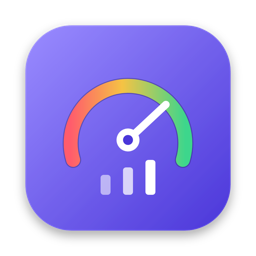
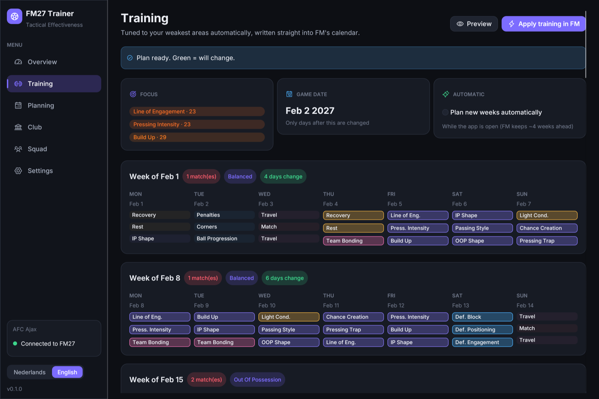
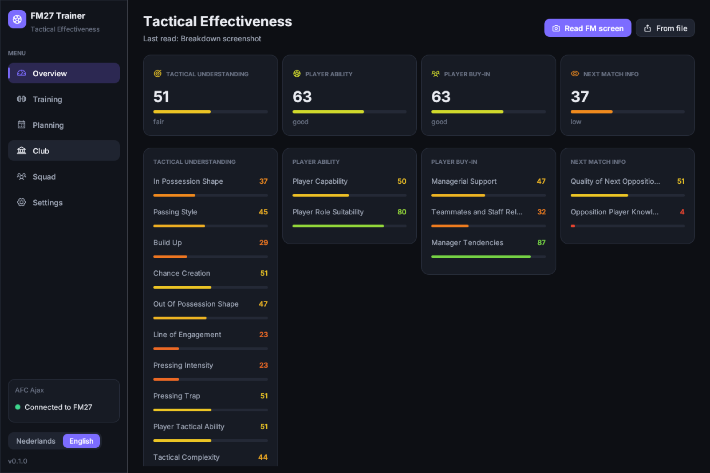
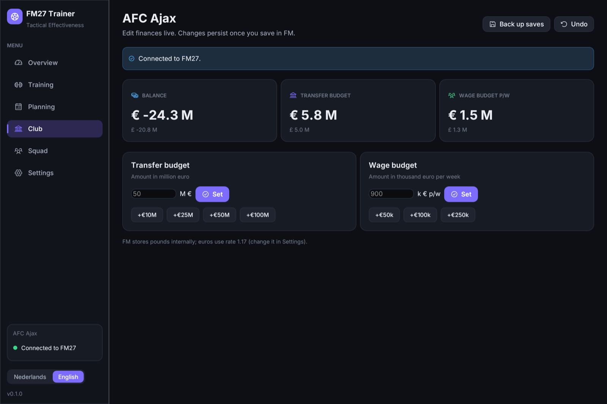
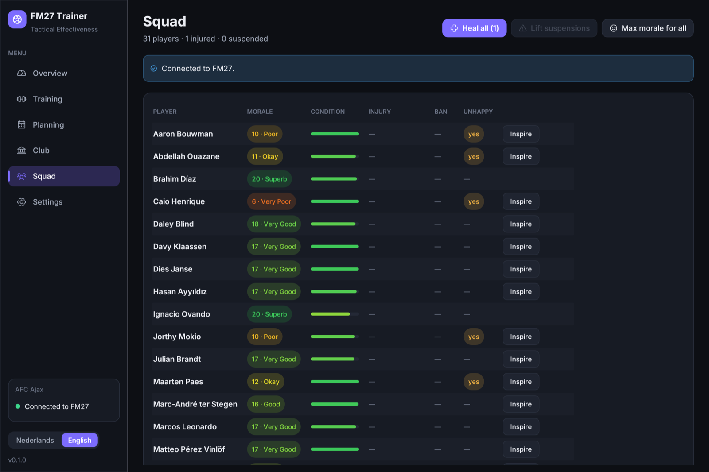

<p align="center">
  
</p>

<h1 align="center">FM27 Trainer</h1>

<p align="center">
  <strong>Read your Tactical Effectiveness, let the app train your weakest areas,<br>
  and manage your club live, for Football Manager 27.</strong>
</p>

<p align="center">
  
  
  
  
  
</p>

<p align="center">
  <a href="README.nl.md">Nederlands</a> ·
  <a href="#features">Features</a> ·
  <a href="#install">Install</a> ·
  <a href="#how-it-works">How it works</a> ·
  <a href="docs/TECHNICAL.md">Technical notes</a>
</p>

<p align="center">
  
</p>

---

FM27 introduced **Tactical Effectiveness**: four areas (Tactical Understanding, Player Ability, Player Buy-In,
Next Match Info) and 17 key factors that all have to go up through training and management. FM27 Trainer
reads those values from your game, works out a training plan aimed at your weakest areas, and writes it
straight into FM's training calendar, week after week.

## Features

**Read Tactical Effectiveness.** Open the *Breakdown* in FM and press *Read FM screen*. The app captures the
window, reads the labels with on-device OCR and measures all 17 pie gauges and 4 bars.

<p align="center"></p>

**Automatic training, straight into FM.** *Apply training in FM* plans every upcoming week around your real
fixtures and writes the sessions into FM's own calendar. The rhythm comes from Sports Interactive's own presets:
recovery after a match, match preparation the day before, conditioning in pre-season. The tactical slots go to
your weakest areas. Match and travel days are left to FM, and nothing on or before today is touched.
FM's assistant re-plans the next one or two weeks every week (and whenever fixtures change), so
*Keep training on plan automatically* checks every few seconds while the app is open and puts any change
back. The activity log shows exactly what FM wanted and what was restored.

**Club tools.** Set the transfer and wage budget, heal injuries, lift suspensions, and bring morale back to the
top. Every change can be undone, and it only sticks once you save in FM.

<p align="center">
  
  
</p>

**Planning and export.** Week and season plans as HTML (printable), CSV and JSON, even without the live module.

**English and Dutch.** Follows your system language; switch any time in the sidebar.

## Install

### macOS

1. Download `FM27-Trainer-<version>.dmg` from [Releases](../../releases) and drag **FM27 Trainer** to *Applications*.
2. First launch: allow **Screen Recording** (System Settings → Privacy & Security), so the app can read the Breakdown.
3. For the live features: save and quit FM, click **Start FM with module** in the app (Steam must be open),
   then load your save. The app connects by itself.

> FM27 Trainer starts Football Manager itself, with a small module loaded alongside it. Starting FM from Steam
> works too, but then only reading and planning are available.

### Windows

1. Download `FM27-Trainer-Windows.zip` from [Releases](../../releases), unzip it and run **FM27 Trainer.exe**. The
   exe is not code-signed yet: if SmartScreen warns, click *More info → Run anyway*.
2. Start FM27 as usual (or with *Start FM27* in the app) and load your save. The app reads `fm.exe` directly, so
   there is nothing to install and no module to load.

> **Beta.** Everything works on Windows, but the Windows build of FM27 has not been live-tested yet, so the app
> starts read-only. Check that club, budget and squad match what FM shows, back up your save, then turn on
> *Allow changes on an untested FM build* in Settings.

## How it works

| Part | What it does |
|---|---|
| Screen reading | Captures the FM window, finds the 17 factor labels with OCR (Apple Vision / Windows OCR) and measures each pie gauge: FM fills it clockwise from 12 o'clock and colours it from red to green. |
| Planner | Uses the 59 training sessions and 99 presets from FM27's own game data (names, weekly limits, effects). It keeps SI's rhythm around matches and allocates the tactical slots by deficit, re-targeting every few weeks. |
| Live module | On macOS a small library that starts with FM (the same approach as [FMSuperScout](https://github.com/mavarobli/FMSuperScout)); on Windows the app reads `fm.exe` directly. It finds the game's objects by their C++ class names and the game's own tables, and only reads or writes when the app asks, after checking the memory still holds what it expects. |

More detail, including memory layouts and file formats: [docs/TECHNICAL.md](docs/TECHNICAL.md).

## Safety

- **Single-player only.** The app never touches online play.
- **Verified builds only.** The module writes only on FM builds whose layout has been measured and tested. On an
  untested build (the Windows version for now, or after an FM patch) it is read-only until you allow changes in
  Settings.
- **Undo** for every change, and **Back up saves** with one click (`~/Documents/FM27 Trainer/backups`).
- Nothing leaves your machine: no account, no telemetry, no network calls.

## Build from source

Requires Rust (stable) and, on macOS, the Xcode command line tools.

```bash
./bundle.sh                # dev build: dist/FM27 Trainer.app for this Mac
./release.sh               # universal app, Developer ID signed, notarised, in a .dmg
cargo run -p fm27-trainer  # run without bundling
```

`release.sh` signs with the first *Developer ID Application* identity in your keychain and notarises when a
`notarytool` profile named `fm27-notary` exists. The GitHub workflow in `.github/workflows/release.yml` builds
the macOS DMG and a Windows zip for every `v*` tag.

Project layout: `app/` (the app: egui UI, OCR, planner, live client), `agent/` (the module that runs inside
FM), `tools/` (scripts for FM's `.fmf` archives and binary JSON), `docs/`.

## Roadmap

- An in-app update check.
- Live-test the Windows build, so changes no longer need to be allowed by hand.
- Reading Tactical Effectiveness straight from memory instead of the screen.

## Credits

Research and memory layouts build on the public work of [FMSuperScout](https://github.com/mavarobli/FMSuperScout),
[FMLibreEditor](https://github.com/tozmoz/FMLibreEditor), [fm-lens](https://github.com/IamDejman/fm-lens) and
[fmsave](https://github.com/rhiever/fmsave). Font: [Inter](https://github.com/rsms/inter) (SIL OFL). Icons:
[Phosphor](https://phosphoricons.com) (MIT). See [THIRD_PARTY.md](THIRD_PARTY.md).

## Disclaimer

FM27 Trainer is an independent fan project. It is not affiliated with, endorsed by or connected to Sports
Interactive or SEGA. Football Manager is a trademark of Sports Interactive / SEGA. Use it at your own risk and
keep backups of your saves.

## License

[MIT](LICENSE) © 2026 Sem Hiel
