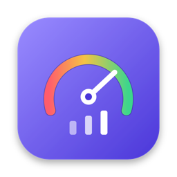
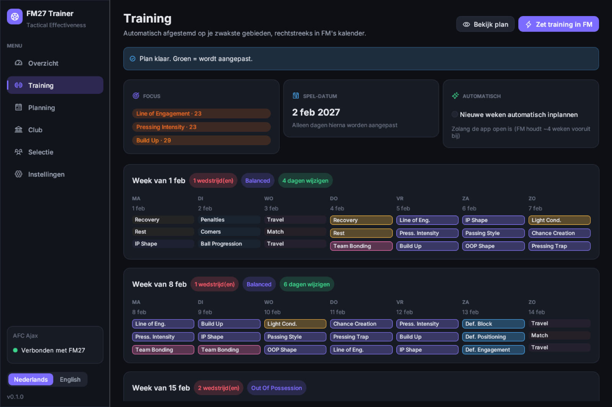

<p align="center">
  
</p>

<h1 align="center">FM27 Trainer</h1>

<p align="center">
  <strong>Lees je Tactical Effectiveness uit, laat de app je zwakste gebieden trainen<br>
  en beheer je club live, voor Football Manager 27.</strong>
</p>

<p align="center">
  <a href="README.md">English</a> ·
  <a href="#functies">Functies</a> ·
  <a href="#installeren">Installeren</a> ·
  <a href="#hoe-het-werkt">Hoe het werkt</a> ·
  <a href="docs/TECHNICAL.md">Technische notities</a>
</p>

<p align="center">
  
</p>

---

FM27 introduceerde **Tactical Effectiveness**: vier onderdelen (Tactical Understanding, Player Ability, Player
Buy-In, Next Match Info) en 17 key factors die allemaal omhoog moeten via training en management. FM27 Trainer
leest die waarden uit je spel, maakt een trainingsplan dat op je zwakste gebieden mikt, en zet het rechtstreeks
in FM's trainingskalender, week na week.

## Functies

- **Tactical Effectiveness uitlezen.** Open de *Breakdown* in FM en klik *Lees FM-scherm*. De app legt het
  venster vast, leest de labels met OCR op je eigen Mac en meet alle 17 taartmeters en 4 balken uit.
- **Training automatisch in FM.** *Zet training in FM* plant elke komende week rond je echte wedstrijden en
  schrijft de sessies in FM's eigen kalender. Het ritme komt uit de presets van Sports Interactive (herstel na
  een wedstrijd, Match Preparation de dag ervoor, conditie in de voorbereiding); de tactische sessies gaan naar je
  zwakste gebieden. Wedstrijd- en reisdagen blijven van FM, en niets op of vóór vandaag wordt aangepast. Met
  *Nieuwe weken automatisch inplannen* krijgt elke nieuwe week meteen jouw plan.
- **Club en selectie.** Transfer- en loonbudget instellen, blessures genezen, schorsingen opheffen, moraal naar de
  top. Alles is ongedaan te maken en blijft pas bewaard als je in FM opslaat.
- **Planning en export.** Week- en seizoensplan als HTML (printbaar), CSV en JSON, ook zonder module.
- **Nederlands en Engels.** Volgt de taal van je systeem; wisselen kan altijd in de zijbalk.

## Installeren

### macOS

1. Download `FM27-Trainer-<versie>.dmg` bij [Releases](../../releases) en sleep **FM27 Trainer** naar *Apps*.
2. Eerste start: sta **Schermopname** toe (Systeeminstellingen → Privacy en beveiliging), zodat de app de
   Breakdown kan uitlezen.
3. Voor de live-functies: sla op en sluit FM, klik **Start FM met module** (Steam moet open zijn) en laad je
   save. De app verbindt vanzelf.

### Windows

Uitlezen, planning en export werken op Windows (met Windows.Media.Ocr). De live-module (training in FM,
club en selectie) is voorlopig alleen voor macOS.

## Hoe het werkt

| Onderdeel | Wat het doet |
|---|---|
| Scherm uitlezen | Legt het FM-venster vast, vindt de 17 labels met OCR en meet elke taartmeter: FM vult die met de klok mee vanaf 12 uur en kleurt van rood naar groen. |
| Planner | Gebruikt de 59 sessies en 99 presets uit FM27's eigen game-data (namen, limieten per week, effecten), houdt het ritme van SI rond wedstrijden aan en verdeelt de tactische sessies naar tekort. |
| Live-module | Een kleine bibliotheek die met FM meestart (zoals [FMSuperScout](https://github.com/mavarobli/FMSuperScout)). Hij vindt de objecten van de game via hun C++-klassenamen en leest of schrijft alleen op verzoek, na controle. |

## Veiligheid

- **Alleen single-player.**
- **Alleen geteste builds.** Na een FM-patch schakelt de module naar alleen lezen tot de app is bijgewerkt.
- **Ongedaan maken** voor elke wijziging en **Backup saves** met één klik.
- Er gaat niets van je computer af: geen account, geen telemetrie.

## Zelf bouwen

```bash
./bundle.sh     # ontwikkelversie voor deze Mac
./release.sh    # universele app, ondertekend met Developer ID, genotariseerd, in een .dmg
```

## Disclaimer

FM27 Trainer is een onafhankelijk fanproject en niet verbonden aan Sports Interactive of SEGA. Football Manager
is een handelsmerk van Sports Interactive / SEGA. Gebruik op eigen risico en bewaar backups van je saves.

## Licentie

[MIT](LICENSE) © 2026 Sem Hiel
