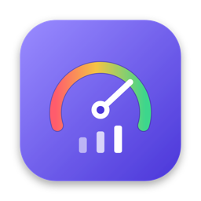

<p align="center">
  
</p>

<h1 align="center">FM27 Trainer</h1>

<p align="center">
  <strong>Leia sua Eficácia Tática, deixe o app treinar suas áreas mais fracas<br>
  e gerencie seu clube ao vivo, para o Football Manager 27.</strong>
</p>

<p align="center">
  <a href="README.md">English</a> ·
  <a href="README.nl.md">Nederlands</a> ·
  <a href="#recursos">Recursos</a> ·
  <a href="#instalação">Instalação</a> ·
  <a href="#como-funciona">Como funciona</a>
</p>

---

O FM27 trouxe a **Eficácia Tática** (Tactical Effectiveness): quatro áreas (Tactical Understanding, Player Ability,
Player Buy-In, Next Match Info) e 17 fatores-chave que precisam subir com treino e gestão. O FM27 Trainer lê esses
valores do seu jogo, monta um plano de treino focado nas suas áreas mais fracas e o escreve direto no calendário de
treino do FM, semana após semana.

## Recursos

**Ler a Eficácia Tática.** Abra o *Detalhamento* (Breakdown) no FM e clique em *Ler tela do FM*. O app captura a
janela, lê os rótulos com OCR local e mede os 17 medidores de pizza e as 4 barras.

**Treino automático, direto no FM.** *Aplicar treino agora* planeja cada semana seguinte em torno dos seus jogos
reais e escreve as sessões no calendário do próprio FM. O ritmo vem das predefinições da Sports Interactive:
recuperação depois do jogo, preparação na véspera, condicionamento na pré-temporada. Os horários táticos vão para
suas áreas mais fracas. Dias de jogo e de viagem ficam com o FM, e nada de hoje ou antes é alterado.
O assistente do FM replaneja as próximas uma ou duas semanas toda semana, então *Manter o treino no plano
automaticamente* verifica a cada poucos segundos enquanto o app está aberto e desfaz qualquer mudança. O registro
de atividade mostra exatamente o que o FM queria e o que foi restaurado.

**Ferramentas do clube.** Defina o orçamento de transferências e salarial, cure lesões, anule suspensões e leve a
moral ao máximo. Toda mudança pode ser desfeita e só fica quando você salva no FM.

**Transferências.** Venda um jogador direto para qualquer clube, ou compre: escolha um clube, um jogador do time
principal, defina valor e salário, verifique, e ele está no seu elenco; o dinheiro passa entre os dois clubes na
hora. Tudo pode ser desfeito até você salvar no FM.

**Regras.** A página Clube tem os dois interruptores que o editor do jogo do FM oferece para seu treinador:
inscrever jogadores a qualquer momento e trocar números de camisa a qualquer momento.

**Entrosamento tático.** A página Elenco mostra quão bem o elenco conhece sua tática atual, por área, e pode
maximizar com um clique: o entrosamento de cada jogador em cada configuração vai a 100 %. O FM deixa cair de novo
a cada semana de jogo, então há um interruptor para mantê-lo em 100 % enquanto o app estiver aberto.

**Táticas.** A página Táticas lê sua tática do FM (funções com e sem a bola, posições, atributos) e mostra, por
lugar, quão bem o jogador se encaixa, quem no elenco encaixaria melhor, o melhor onze para a tática e funções que
combinam mais com cada jogador. As notas são estimativas do próprio app; nada é alterado no FM.

**Planejamento e exportação.** Planos semanais e da temporada em HTML (imprimível), CSV e JSON, mesmo sem o módulo.

**Português, inglês e holandês.** Segue o idioma do sistema; troque quando quiser na barra lateral. Valores em real ou euro, com a cotação atual (Configurações → Moeda).

## Instalação

### Windows

1. Baixe o [FM27-Trainer-Windows.zip](../../releases/latest/download/FM27-Trainer-Windows.zip), descompacte e rode **FM27 Trainer.exe**. O exe não é assinado: se o SmartScreen avisar, clique em
   *Mais informações → Executar assim mesmo*.
2. Abra o FM27 normalmente (ou com *Iniciar FM27* no app) e carregue seu save. O app lê o `fm.exe` diretamente,
   então não há nada para instalar nem módulo para carregar.

> Depois de um patch do FM o app continua lendo, mas fica só leitura até a nova versão ser verificada; você mesmo
> pode permitir alterações em Configurações (faça backup do save antes). FM em console Xbox não pode ser lido: o FM
> precisa rodar no mesmo PC.

### macOS

Baixe o [FM27-Trainer-macOS.dmg](../../releases/latest/download/FM27-Trainer-macOS.dmg), arraste para *Aplicativos* e permita **Gravação de Tela** em Ajustes do Sistema.

## Como funciona

| Parte | O que faz |
|---|---|
| Leitura da tela | Captura a janela do FM, encontra os 17 rótulos com OCR (Apple Vision / OCR do Windows) e mede cada medidor de pizza: o FM o preenche no sentido horário a partir das 12h e colore de vermelho a verde. |
| Planejador | Usa as 59 sessões de treino e 99 predefinições dos dados do próprio FM27. Mantém o ritmo da SI em torno dos jogos e distribui os horários táticos conforme o déficit, redefinindo os alvos a cada poucas semanas. |
| Módulo ao vivo | No macOS, uma pequena biblioteca que inicia com o FM; no Windows o app lê o `fm.exe` diretamente. Encontra os objetos do jogo pelos nomes das classes C++ e só lê ou escreve quando o app pede, depois de conferir que a memória ainda tem o esperado. |

## Segurança

- **Só modo single-player.** O app nunca mexe no jogo online.
- **Só versões verificadas.** O módulo só escreve em versões do FM cujo layout foi medido e testado; nas outras fica
  só leitura até você permitir alterações em Configurações.
- **Desfazer** para toda alteração, e **Fazer backup dos saves** com um clique (`Documentos/FM27 Trainer/backups`).
- Nada sobre você sai do seu computador: sem conta, sem telemetria. A única conexão de rede é buscar a cotação atual (libra → euro/real, dados do BCE) ao abrir o app; nenhum dado é enviado.

## Compilar do código-fonte

Requer Rust (stable, toolchain MSVC no Windows) e o Visual Studio Build Tools (C++).

```bash
cargo build --release -p fm27-trainer   # → target/release/fm27-trainer.exe
cargo run -p fm27-trainer               # rodar direto
```

## Créditos e aviso

Projeto original de Sem Hiel ([SemHiel2003/fm27-trainer](https://github.com/SemHiel2003/fm27-trainer)), licença
[MIT](LICENSE); apoie o autor no [Ko-fi](https://ko-fi.com/semhiel). O FM27 Trainer é um projeto independente de fãs,
sem vínculo com a Sports Interactive ou a SEGA. Football Manager é marca da Sports Interactive / SEGA. Use por sua
conta e risco e mantenha backups dos seus saves.
